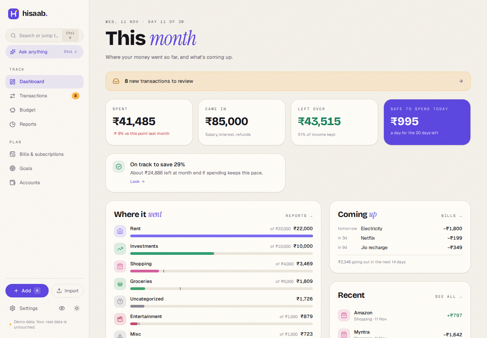
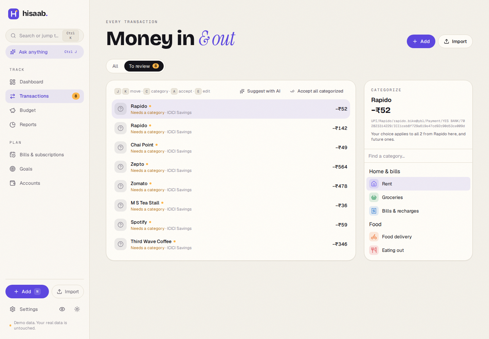
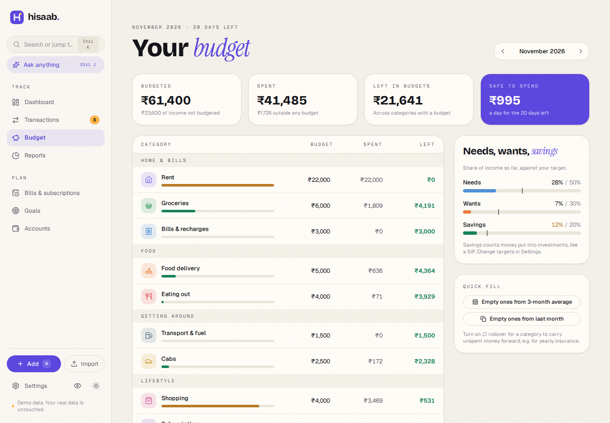
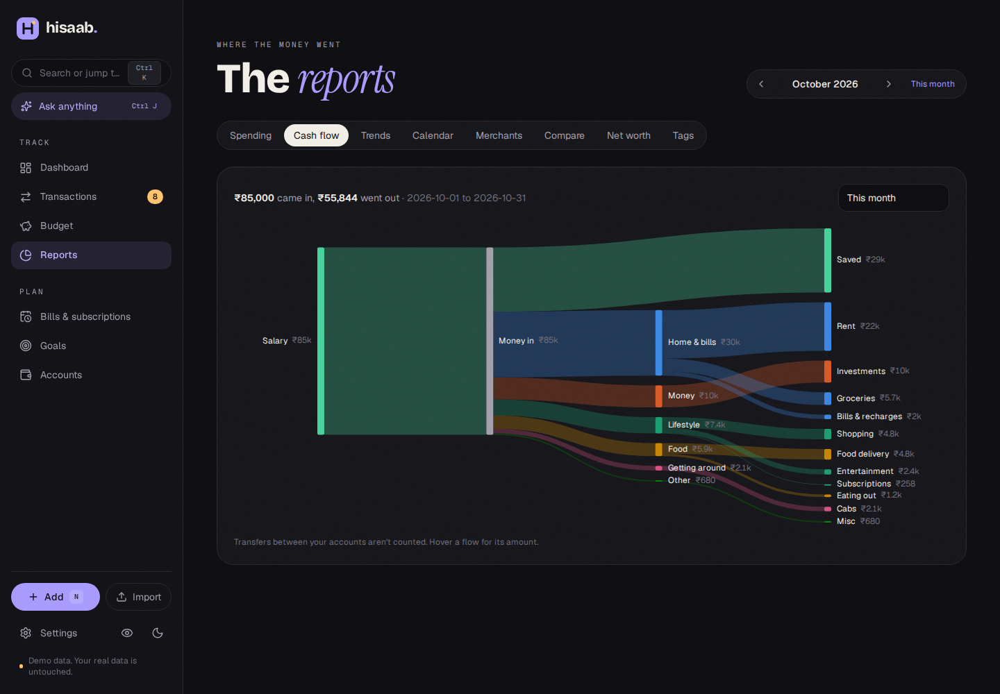

<p align="center">
  <picture>
    <source media="(prefers-color-scheme: dark)" srcset="assets/screenshots/dashboard-dark.png">
    
  </picture>
</p>

<h1 align="center">Hisaab</h1>

<p align="center">
  <b>Know where every rupee went.</b><br>
  A personal finance tracker that runs on your own computer. Import your bank statement, see where the money went,<br>
  set a budget, and ask questions about your money. No account, no cloud, no tracking.
</p>

<p align="center">
  <a href="https://github.com/sakshamm21/Hisaab/actions/workflows/ci.yml"></a>
  
  
  
</p>

## Install

You need Python 3.11 or newer. [pipx](https://pipx.pypa.io) keeps Hisaab in its own space:

```bash
pipx install https://github.com/sakshamm21/Hisaab/releases/download/v1.0.0/hisaab-1.0.0-py3-none-any.whl
hisaab --demo
```

`--demo` opens Hisaab in your browser with six months of made-up data, kept in a separate file. When you're ready, run plain `hisaab` and it walks you through setting up your own accounts. Your data lives in one file on your computer (`~/.local/share/hisaab/hisaab.db` on Linux), with a backup made every day you use it.

| Command | What it does |
|---|---|
| `hisaab` | Start with your data and open it in the browser |
| `hisaab --demo` | Explore with sample data; your real data is untouched |
| `hisaab --window` | Open in its own desktop window (needs `pipx inject hisaab pywebview`) |
| `hisaab backup` | Save a backup now |
| `hisaab --data-dir PATH` | Keep the data somewhere else, e.g. a synced folder |

## What it does

**Track.** Drop in your bank statement: the **ICICI savings statement PDF** is read directly, and any bank's **CSV or Excel** export works too. Every row is checked against the statement's running balance, re-imports skip duplicates, and any import can be undone. UPI, NACH, IMPS and card descriptions are read to find who you paid, common merchants (Swiggy, Zepto, Uber, Jio, …) are categorized automatically, and every category you pick is remembered. Cash spends take ten seconds: press <kbd>N</kbd> and type `450 zomato`.

<p align="center"></p>

**Plan.** Set a monthly budget per category (or let Hisaab fill one in from your last three months), see how much is **safe to spend today**, carry unspent money forward, and check your needs / wants / savings split. Rent, SIPs and subscriptions are spotted automatically and tracked as bills; savings goals tell you how much to put aside each month. Your month can start on salary day.

<p align="center"></p>

**Understand.** A cash-flow diagram of where your income went, 12-month trends, a daily spending calendar, top merchants, month-against-month comparisons and net worth. Insight cards point out what changed (a category running hot, a subscription that went up, a possible double charge), and **Month in review** sums up the last month and helps you plan the next.

<p align="center"></p>

**Ask.** An optional AI assistant (<kbd>Ctrl/⌘</kbd> <kbd>J</kbd>) answers questions like *"Where did my money go last month?"* or *"Can I afford a ₹40,000 phone in March?"* by looking things up in your data. Bring your own [OpenRouter](https://openrouter.ai) key (free models work), or run a model offline with Ollama. See [docs/ai.md](docs/ai.md).

## Privacy

- Everything stays in one SQLite file on your computer. Hisaab listens only on `127.0.0.1` and sends nothing anywhere, ever, unless you turn on the AI assistant.
- With the assistant on, only small summaries are sent (like "Food delivery: ₹8,420 in October"), never your statements or database. People you pay show up as "Person A". Settings → AI lists every request that was sent.
- Your AI key is kept in a private file outside the database, so backups and exports never contain it.
- Export everything to CSV or JSON at any time from Settings.

## Development

```bash
git clone https://github.com/sakshamm21/Hisaab.git && cd Hisaab
python3 -m venv .venv && .venv/bin/pip install -e '.[dev]'
cd web && npm install && npm run build && cd ..
.venv/bin/hisaab --demo
```

For UI work, run the API and the Vite dev server side by side: `.venv/bin/hisaab --demo --no-browser` and `cd web && npm run dev` (UI on http://localhost:5173, proxying `/api`).

| Folder | Contents |
|---|---|
| `hisaab/` | Python package: FastAPI app, CLI, SQLite migrations, importers, categorizer, budgets, recurring, insights, AI |
| `hisaab/importer/` | ICICI PDF reader, CSV/Excel reader, UPI/NACH/IMPS narration parser, duplicate detection |
| `hisaab/ai/` | OpenAI-compatible client, read-only tools, agent loop, privacy masking, offline models |
| `web/` | React + TypeScript + Vite + Tailwind UI, built into `hisaab/static/` |
| `tests/` | pytest suite; all fixtures use invented data |

Checks: `.venv/bin/pytest`, `.venv/bin/ruff check .`, `cd web && npm run build`. Releases: push a `v*` tag and GitHub Actions builds the wheel and creates a release. [PLAN.md](PLAN.md) has the full design.

Adding your bank's statement format: see [docs/importing.md](docs/importing.md).

## License

[MIT](LICENSE) © Saksham Malhotra
